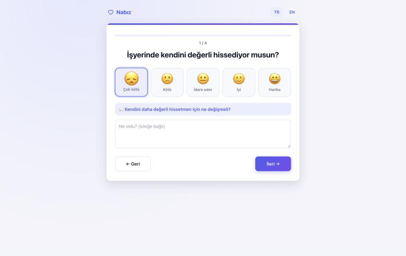
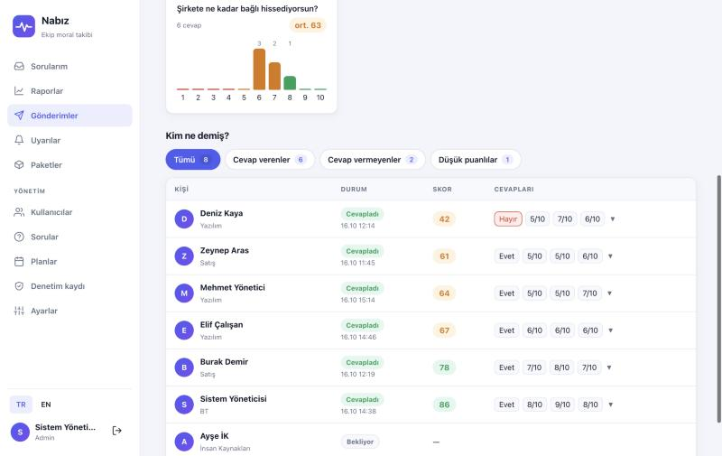
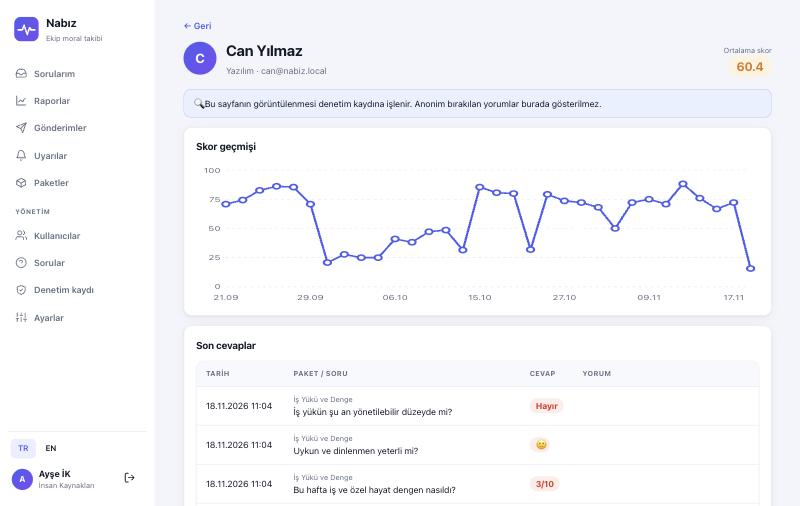
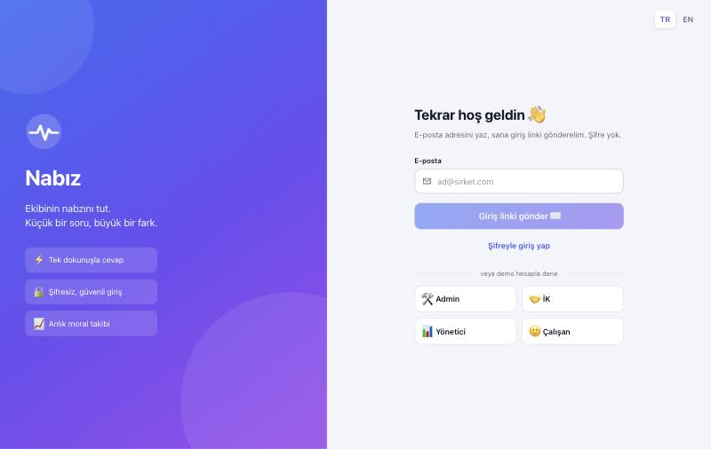
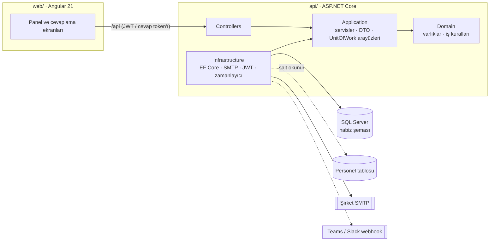

<div align="center">

# 💓 Nabız

**Çalışan esenliği ve moral takibi.** Küçük sorular, büyük içgörüler.

Çalışanlara düzenli olarak kısa **soru paketleri** gönderir, cevapları raporlar ve düşük moral işaretlerini İK'ya erken ulaştırır.


</div>

---

## ✨ Özellikler

| | |
|---|---|
| 📦 **Soru paketleri** | Sorular paket halinde gider (Motivasyon, İş Yükü, Oryantasyon, Uzaktan Çalışma, Yönetici Değerlendirme…). 9 hazır şablon, kendi paketini oluştur. |
| ✉️ **Mail ile gönderim** | Tek ekranda: **Hemen**, **Bir kez** (seçtiğin tarih/saatte) ya da **Tekrarlayan** (her N günde bir). Hedef: **Herkes / Departman / Kişi seç**. Türkçe + İngilizce mail şablonları. |
| 🔔 **Otomatik hatırlatma** | Cevaplamayanlara hafta içi çalışma saatlerinde nazik hatırlatma (en fazla N kez). |
| 🙂 **Adım adım cevaplama** | Tek mail linki, **giriş gerekmez**. Emoji / 1-10 puan / Evet-Hayır. Düşük cevapta nazik bir **takip sorusu**; yorum **anonim** bırakılabilir. |
| 📊 **Raporlar** | Ortalama skor, cevap oranı, olumlu/nötr/olumsuz ağırlık, günlük trend, departman karşılaştırma, soru bazlı dağılım, **önceki dönemle fark**, "kim ne demiş". |
| 🧾 **Gönderim raporu** | Her gönderimin kendi raporu: soru dağılımı, kim ne cevap vermiş, **kim vermemiş**, gitmeyen mailleri tekrar deneme. |
| ⚠️ **Düşük puan uyarıları** | Panelde uyarı, **İK'ya e-posta**, isteğe bağlı **Teams/Slack** bildirimi. Üst üste uyarı alanlar öne çıkar. |
| 👤 **Kişi geçmişi (İK)** | Bir çalışanın zaman içindeki skoru, **düşüş eğilimi** tespiti. |
| ⬇️ **CSV dışa aktarma** | Excel'in doğrudan açtığı (UTF-8 BOM, `;`) CSV. Formül enjeksiyonuna karşı korumalı. |
| 🔒 **Gizlilik ve denetim** | İki rol (**İK** ve **Çalışan**), anonim yorum, her kişisel veri erişimi **denetim kaydında**. |
| 🔗 **Personel senkronu** | Kullanıcılar mevcut personel tablosundan (salt okunur) otomatik gelir. Şifre yönetimi yok. |
| 🔑 **Şifresiz giriş** | E-postaya gelen 15 dakikalık giriş linki. Mobil uygulamadan **WebView otomatik giriş** ([doküman](docs/MOBIL.md)). |
| 🩺 **Sistem durumu** | Veritabanı, SMTP, son 24 saat mail sonuçları tek bakışta; **E-posta testi** düğmesiyle SMTP'yi canlı doğrula. |
| 🌍 **Türkçe + İngilizce** | Tüm arayüz, e-postalar ve hata mesajları iki dilde. Soru ve paketlerde **iki dilden yalnızca birini yazmak yeterli**, diğer dilde aynı metin gösterilir. Kullanıcının dili profilinde saklanır. |

<table>
  <tr>
    <td width="50%"><br><sub><b>Çalışan:</b> adım adım cevaplama, düşük cevapta takip sorusu</sub></td>
    <td width="50%"><br><sub><b>Gönderim raporu:</b> kim ne cevap vermiş, kim vermemiş</sub></td>
  </tr>
  <tr>
    <td><br><sub><b>Yeni gönderim:</b> Hemen / Bir kez / Tekrarlayan, tek ekranda</sub></td>
    <td><br><sub><b>Kişi geçmişi (İK):</b> skor trendi ve düşüş eğilimi</sub></td>
  </tr>
  <tr>
    <td><br><sub><b>Giriş:</b> şifresiz, e-posta linkiyle</sub></td>
    <td></td>
  </tr>
</table>

## 🚀 Hızlı başlangıç (Docker)

Gereken: [Docker Desktop](https://www.docker.com/products/docker-desktop/) (Apple Silicon'da *Settings → General → Use Rosetta* açık olmalı).

```bash
git clone <repo-adresi> nabiz && cd nabiz
docker compose up --build -d
```

| Ne | Adres |
|---|---|
| Uygulama | http://localhost:4200 |
| Gelen mailler (Mailpit, sahte SMTP) | http://localhost:8025 |
| API sağlık | http://localhost:5277/saglik |

Giriş ekranındaki **demo butonlarıyla** (İK / Çalışan) hemen deneyebilirsin.
`ik@nabiz.local` (İK) ve `calisan@nabiz.local` (Çalışan), şifre: `Demo123!`

**Denemek için:**
1. *Gönderimler → Yeni gönderim* ile bir paketi seç, kimlere gideceğini belirle ve **Hemen** gönder (ya da *Bir kez* / *Tekrarlayan* olarak zamanla).
2. http://localhost:8025 adresinden maili aç, **Hemen cevapla**'ya tıkla ve soruları cevapla.
3. *Gönderimler → ilgili gönderim*'de cevapları, *Uyarılar*'da düşük puanları gör.
4. Boş raporları doldurmak için *Ayarlar → Demo veri üret* (sahte veri; "Temizle" yalnızca onu siler).

Sıfırlamak için: `docker compose down -v`

> ⚠️ **Mailler gerçek kutulara gitmez**: varsayılan SMTP, mailleri yakalayan Mailpit'tir. Gerçek teslimatı görmek için [docs/MAIL-TEST.md](docs/MAIL-TEST.md) rehberine bak (Gmail ile 5 dakika; **Ayarlar → E-posta testi** düğmesi sonucu ya da hata nedenini gösterir).

## 🏗️ Mimari



| Katman | Sorumluluk |
|---|---|
| `Nabiz.Domain` | Varlıklar, enum'lar, skor normalizasyonu gibi iş kuralları (bağımlılık yok) |
| `Nabiz.Application` | Servisler, DTO'lar, `IUnitOfWork` + `IRepository<T>` arayüzleri |
| `Nabiz.Infrastructure` | EF Core `DbContext`, `UnitOfWork`/`Repository`, migration'lar, JWT, BCrypt, SMTP, webhook, zamanlayıcı, personel kaynağı |
| `Nabiz.Api` | İnce controller'lar, JWT yapılandırması, hata middleware'i |
| `Nabiz.Tests` | xUnit: iş kuralları ve bellek içi veritabanıyla gizlilik/cevap akışı testleri |
| `web/` | Angular: `core` (servis, guard, interceptor) · `layout` · `shared` · `features` |

## ⚙️ Gerçek ortama alma

1. `cp .env.gercek.example .env.gercek` ve doldur: şirket SQL Server bağlantısı, SMTP, `Jwt__Key`, `Uygulama__PublicUrl`, personel tablosu/sütunları.
2. Demo yığınını kapat: `docker compose down`
3. Başlat:
   ```bash
   docker compose -f docker-compose.gercek.yml --env-file .env.gercek up --build -d
   ```

Uygulama kendi tablolarını **`nabiz` şemasında** oluşturur; personel tablosuna yalnızca **okuma** yapar. Migration'ı DBA'nın uygulaması gerekiyorsa `Baslangic__OtomatikMigration=false` yapıp SQL betiğini verebilirsin ([docs/OPERASYON.md](docs/OPERASYON.md)).

Personel tablosu eşlemesi (`Personel__*`): `Tablo`, `SicilKolon`, `AdKolon`, `EmailKolon`, `DepartmanKolon`, `AktifKolon`.

Tüm ayarlar, gizlilik özeti, yedekleme ve izleme: **[docs/OPERASYON.md](docs/OPERASYON.md)** · Mobil WebView girişi: **[docs/MOBIL.md](docs/MOBIL.md)**

## 🧪 Geliştirme

```bash
# API (appsettings.Development.json içindeki bağlantı cümlesini düzenle ya da yalnızca db servisini başlat: docker compose up -d db mailpit)
cd api && dotnet run --project Nabiz.Api        # http://localhost:5277
cd api && dotnet test Nabiz.Tests                # 53 test

# Web
cd web && npm install && npm start               # http://localhost:4200 (/api → 5277 proxy)
```

Migration:

```bash
cd api && dotnet tool restore
dotnet ef migrations add <Ad> -p Nabiz.Infrastructure -s Nabiz.Api -o Persistence/Migrations
dotnet ef database update -p Nabiz.Infrastructure -s Nabiz.Api
```

## 🔐 Güvenlik notları
- Sırlar (`.env.gercek`, şifreler, `Jwt__Key`) repoda tutulmaz; `.gitignore` bunları dışarıda bırakır.
- Canlıya alırken `web/src/environments/environment.ts` içinde `demoGiris` **false** olmalı (`docker-compose.gercek.yml` bunu otomatik yapar) ve demo veri/hesaplar kapalı olmalıdır.
- Cevap linkleri kişiye özel gizli token'lardır; mail yönlendirmeyle paylaşılırsa başkası cevaplayabilir.

## 🗺️ Durum ve sınırlar
- ✅ Docker üzerinde uçtan uca doğrulandı (mail, cevaplama, raporlar, gizlilik, CSV, denetim, mobil giriş uç noktası).
- ⚠️ **Gerçek SMTP ve gerçek personel tablosuyla**, **Teams/Slack webhook** ile ve gerçek bir **mobil uygulamayla** henüz denenmedi; ayarlar ve uçlar hazır.
- ❌ Push bildirim yok (mobil uygulamanın push altyapısı gerektirir).
- Hatırlatma zamanlaması birim testlidir; gerçek zamanlı akışı en az iki günlük bir pilotla doğrulanmalıdır.

---

<sub>Proje lisansı henüz belirlenmedi; yayımlamadan önce bir `LICENSE` dosyası ekle.</sub>
