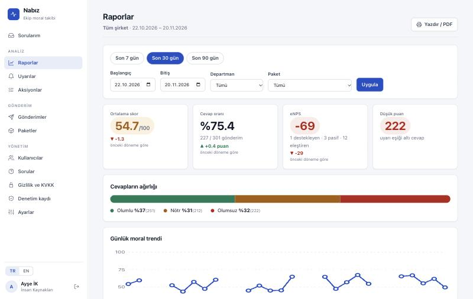
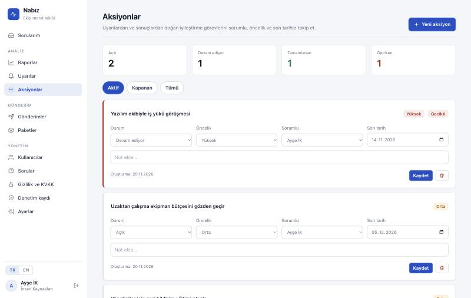
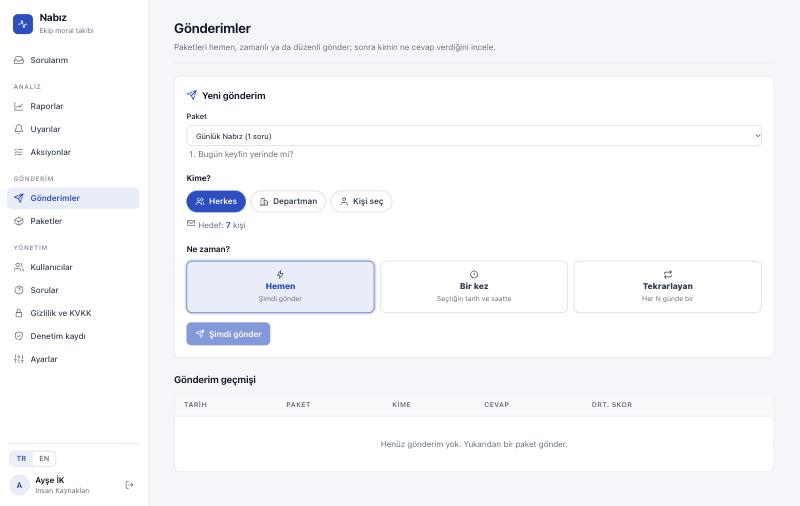
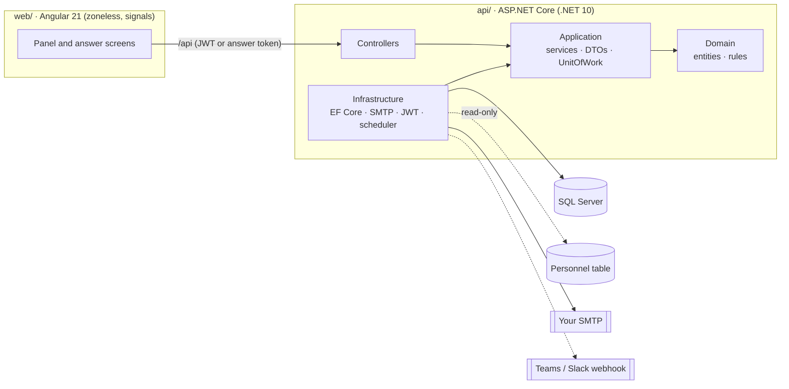

<div align="center">


# Nabız

### Know how your people are *really* doing, before they tell you they're leaving.

Short question packs · one-click answers from email · eNPS · early-warning alerts · KVKK/GDPR tools · white-label.
**Self-hosted. Open source. Turkish + English.**

[**Live demo**](https://ozkurtomer.github.io/Nabiz/) &nbsp;·&nbsp; [Quick start](#quick-start) &nbsp;·&nbsp; [Features](#features) &nbsp;·&nbsp; [Türkçe](README.tr.md) &nbsp;·&nbsp; [Contributing](CONTRIBUTING.md)


<br>



</div>

---

## Why Nabız?

Annual engagement surveys are slow, long and ignored. By the time results arrive, the people who were unhappy have already left.

Nabız sends **one or two tiny questions at a time**, straight to your employees' inbox. Answering takes **five seconds and zero logins**. HR sees the trend as it happens, gets alerted when somebody's morale drops, and can turn the alert into a tracked action, all on **your own server**, with **your own data**.

| Without Nabız | With Nabız |
|---|---|
| One long survey a year | A pulse every week, or whenever you choose |
| Results months later | Live reports and early-warning alerts |
| "Anonymous" in name only | Anonymous comments that even HR can't trace |
| Data on someone else's cloud | Your SQL Server, your SMTP, your rules |
| Per-seat SaaS pricing | Free, forever (MIT) |

## Try it in 10 seconds

> **[Open the live demo](https://ozkurtomer.github.io/Nabiz/)**: answer three questions as an employee and watch the HR report update instantly. It runs fully in your browser, with no sign-up.

Want the real thing? Run it locally with one command:

```bash
git clone https://github.com/ozkurtomer/Nabiz.git nabiz && cd nabiz
docker compose up --build -d
```

Open **http://localhost:4200**, click the **HR** demo button, send a pack, then read the email in **http://localhost:8025** (Mailpit) and answer it.

## Features

<table>
<tr>
<td width="50%" valign="top">

### Collect
- **Question packs**: 9 ready templates (Motivation, Workload, Onboarding, Remote Work, Manager Review, **eNPS**…) or build your own
- **Send now, once, or repeatedly**: pick everyone, a department, or specific people
- **Answer from the inbox**: personal link, **no login**; click an emoji in the email and the answer is pre-selected
- **Emoji, 1-10 and Yes/No** questions with a gentle follow-up when the answer is low
- **Automatic reminders** on working hours, capped at N times

</td>
<td width="50%" valign="top">

### Understand
- **Score, eNPS and trend** with comparison to the previous period
- **Department × week heatmap**
- **Per-send report**: who answered, who didn't, the distribution
- **Per-person history** with downward-trend detection (HR only)
- **Print / PDF** report, **Excel-ready CSV** export

</td>
</tr>
<tr>
<td valign="top">

### Act
- **Low-score alerts** in the panel, by **email to HR**, and optionally to **Teams / Slack**
- **Action tracking**: open an action from an alert with owner, priority, due date and status; overdue ones are flagged
- **Weekly digest email** to HR: score, response rate, new alerts, overdue actions

</td>
<td valign="top">

### Trust
- **Only two roles**: HR and Employee
- **Truly anonymous comments**, with every personal-data access in an **audit log**
- **KVKK / GDPR tools**: retention with automatic deletion, editable privacy notice, per-person **data export and erasure**
- **Rate limiting, login lockout, CSP and security headers**
- Passwordless **magic-link sign-in** and **mobile WebView auto-login**

</td>
</tr>
</table>

**And also:** white-label branding (company name and colour in the panel, answer page and emails) · Turkish + English everywhere (question text too: write just one language and it falls back to the other) · staff sync from an existing read-only personnel table · system health page with a live **SMTP test** · clean, light, corporate design.

<table>
  <tr>
    <td width="50%"><br><sub><b>Action tracking</b>: owner, priority, due date</sub></td>
    <td width="50%"><br><sub><b>New send</b>: now / once / repeating, one screen</sub></td>
  </tr>
</table>

## Quick start

You only need [Docker Desktop](https://www.docker.com/products/docker-desktop/) (on Apple Silicon enable *Settings → General → Use Rosetta*).

```bash
docker compose up --build -d
```

| What | Where |
|---|---|
| App | http://localhost:4200 |
| Captured emails (Mailpit, fake SMTP) | http://localhost:8025 |
| API health | http://localhost:5277/saglik |

Demo accounts: `ik@nabiz.local` (HR) and `calisan@nabiz.local` (Employee), password `Demo123!` (local demo only). In the panel, *Settings → Generate demo data* fills the reports with fake data.

> Emails never leave your machine by default: they land in Mailpit. To see real delivery follow [docs/MAIL-TEST.md](docs/MAIL-TEST.md) (5 minutes with Gmail).

Reset everything with `docker compose down -v`.

## Architecture



Clean layers (Domain → Application → Infrastructure → Api), `UnitOfWork` + `IRepository<T>`, 61 xUnit tests with an in-memory database, CI on every push.

## Go to production

1. `cp .env.gercek.example .env.gercek` and fill in your SQL Server, SMTP, `Jwt__Key` and `Uygulama__PublicUrl`.
2. `docker compose -f docker-compose.gercek.yml --env-file .env.gercek up --build -d`

Nabız creates its own tables in a dedicated `nabiz` schema and only **reads** your personnel table. Everything else (backups, monitoring, DBA-applied migrations, privacy summary) is in **[docs/OPERASYON.md](docs/OPERASYON.md)**; mobile sign-in is in **[docs/MOBIL.md](docs/MOBIL.md)**.

## Development

```bash
cd api && dotnet run --project Nabiz.Api     # http://localhost:5277
cd api && dotnet test Nabiz.Tests            # 61 tests
cd web && npm install && npm start           # http://localhost:4200
```

## Status and honesty

Verified end to end on Docker (email, answering, reports, privacy, CSV, audit, mobile login endpoint). **Not yet exercised** against a real SMTP server, a real personnel table, a Teams/Slack webhook or a real mobile app: the settings and endpoints are ready, so please pilot for a couple of days before rolling out. There is no push-notification layer.

## Contributing

Nabız is young and **contributions are very welcome**: bug reports, translations, new question packs, report ideas, docs, tests. Start with [CONTRIBUTING.md](CONTRIBUTING.md) or pick a [good first issue](https://github.com/ozkurtomer/Nabiz/labels/good%20first%20issue). Ideas we'd love help with:

- [ ] Slack/Teams interactive answers
- [ ] More languages (German, French, Spanish…)
- [ ] OpenAPI / Swagger document
- [ ] Export reports to PowerPoint
- [ ] Optional SSO (Entra ID / Google)

If Nabız is useful to you, **please give it a star**. It helps other people find it.

## License

[MIT](LICENSE) © 2026 Ömer Özkurt
