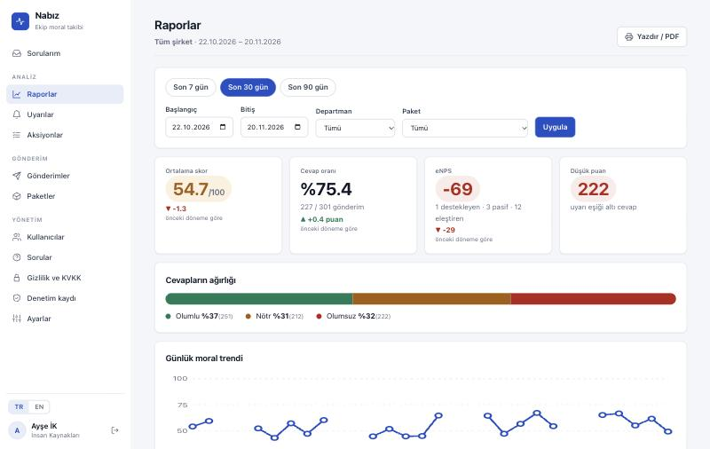
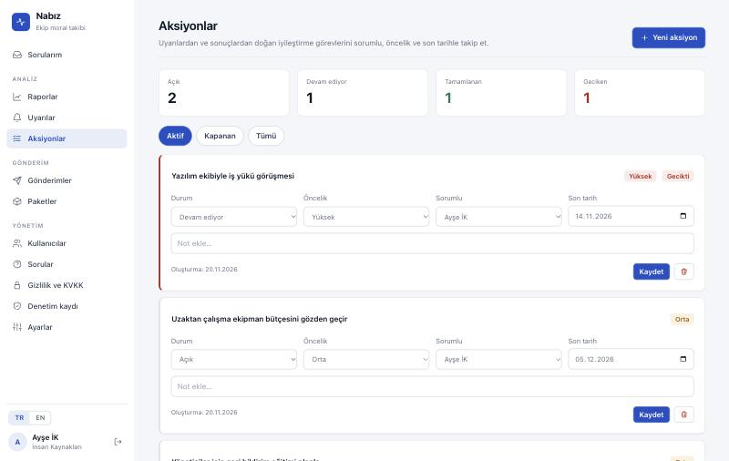
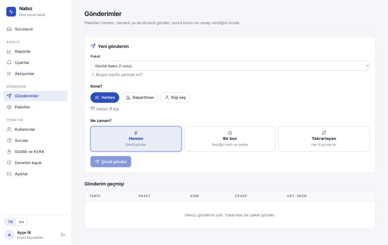
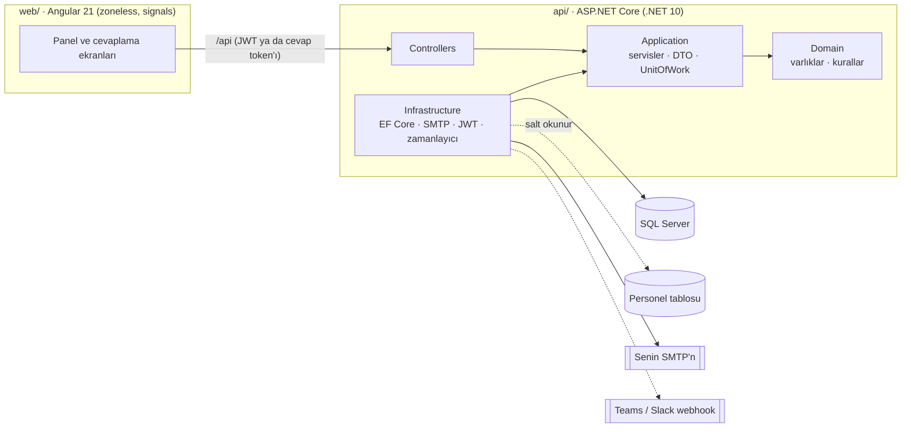

<div align="center">


# Nabız

### Çalışanların gerçekten nasıl olduğunu, *ayrılmadan önce* öğren.

Kısa soru paketleri · maildeki emojiye tek tıkla cevap · eNPS · erken uyarı · KVKK araçları · kendi markan.
**Kendi sunucunda. Açık kaynak. Türkçe + İngilizce.**

[**Canlı demo**](https://ozkurtomer.github.io/Nabiz/) &nbsp;·&nbsp; [Hızlı başlangıç](#hızlı-başlangıç) &nbsp;·&nbsp; [Özellikler](#özellikler) &nbsp;·&nbsp; [English](README.md) &nbsp;·&nbsp; [Katkı](CONTRIBUTING.md)


<br>



</div>

---

## Neden Nabız?

Yıllık memnuniyet anketleri uzun, yavaş ve çoğu zaman yok sayılır. Sonuçlar geldiğinde mutsuz olanlar çoktan istifa etmiş olur.

Nabız çalışanlara **bir seferde bir iki küçük soru** gönderir. Cevaplamak **beş saniye sürer, giriş gerektirmez**. İK trendi anında görür, birinin morali düştüğünde uyarı alır ve uyarıyı takip edilen bir aksiyona çevirir. Hepsi **kendi sunucunda**, **kendi verinle**.

| Nabız olmadan | Nabız ile |
|---|---|
| Yılda bir uzun anket | Her hafta ya da istediğin sıklıkta nabız |
| Aylar sonra sonuç | Canlı rapor ve erken uyarı |
| Adı "anonim" | İK'nın bile izini süremediği gerçek anonim yorum |
| Başkasının bulutunda veri | Senin SQL Server'ın, senin SMTP'n, senin kuralların |
| Kişi başı abonelik | Sonsuza dek ücretsiz (MIT) |

## 10 saniyede dene

> **[Canlı demoyu aç](https://ozkurtomer.github.io/Nabiz/)**: çalışan gibi üç soruyu cevapla, İK raporunun anında güncellendiğini gör. Tamamen tarayıcında çalışır, kayıt gerekmez.

Gerçeğini denemek için tek komut:

```bash
git clone https://github.com/ozkurtomer/Nabiz.git nabiz && cd nabiz
docker compose up --build -d
```

**http://localhost:4200** adresini aç, **İK** demo düğmesine tıkla, bir paket gönder, sonra maili **http://localhost:8025** (Mailpit) adresinde aç ve cevapla.

## Özellikler

<table>
<tr>
<td width="50%" valign="top">

### Topla
- **Soru paketleri**: 9 hazır şablon (Motivasyon, İş Yükü, Oryantasyon, Uzaktan Çalışma, Yönetici Değerlendirme, **eNPS**…) ya da kendi paketin
- **Hemen, bir kez ya da tekrarlayan** gönderim: herkes, departman ya da seçtiğin kişiler
- **Gelen kutusundan cevap**: kişiye özel link, **giriş yok**; maildeki emojiye tıklayınca cevap seçili açılır
- **Emoji, 1-10 puan, Evet/Hayır** soruları; düşük cevapta nazik takip sorusu
- Çalışma saatlerinde **otomatik hatırlatma**, en fazla N kez

</td>
<td width="50%" valign="top">

### Anla
- **Skor, eNPS ve trend**, önceki dönemle karşılaştırmalı
- **Departman × hafta ısı haritası**
- **Gönderim raporu**: kim cevapladı, kim cevaplamadı, dağılım
- **Kişi geçmişi** ve düşüş eğilimi tespiti (yalnızca İK)
- **Yazdır / PDF** rapor, **Excel'in açtığı CSV**

</td>
</tr>
<tr>
<td valign="top">

### Harekete geç
- **Düşük puan uyarısı**: panelde, **İK'ya e-posta** ve isteğe bağlı **Teams / Slack**
- **Aksiyon takibi**: uyarıdan aksiyon aç; sorumlu, öncelik, son tarih, durum; gecikenler işaretlenir
- İK'ya **haftalık özet e-postası**: skor, cevap oranı, yeni uyarı, geciken aksiyon

</td>
<td valign="top">

### Güven
- **Yalnızca iki rol**: İK ve Çalışan
- **Gerçek anonim yorum**; kişisel veriye her erişim **denetim kaydında**
- **KVKK araçları**: saklama süresi ve otomatik silme, düzenlenebilir aydınlatma metni, kişi bazlı **dışa aktarma ve silme**
- **Hız sınırı, giriş kilidi, CSP ve güvenlik başlıkları**
- Şifresiz **giriş linki** ve **mobil WebView otomatik giriş**

</td>
</tr>
</table>

**Ayrıca:** kendi markan (şirket adı ve rengi panelde, cevap ekranında ve mailde) · her yerde Türkçe + İngilizce (soru metninde de: tek dil yazman yeter, diğeri aynısını gösterir) · mevcut personel tablosundan salt okunur senkron · canlı **SMTP testi** olan sistem durumu sayfası · sade, açık renkli, kurumsal tasarım.

<table>
  <tr>
    <td width="50%"><br><sub><b>Aksiyon takibi</b>: sorumlu, öncelik, son tarih</sub></td>
    <td width="50%"><br><sub><b>Yeni gönderim</b>: hemen / bir kez / tekrarlayan, tek ekranda</sub></td>
  </tr>
</table>

## Hızlı başlangıç

Tek gereken [Docker Desktop](https://www.docker.com/products/docker-desktop/) (Apple Silicon'da *Settings → General → Use Rosetta* açık olmalı).

```bash
docker compose up --build -d
```

| Ne | Adres |
|---|---|
| Uygulama | http://localhost:4200 |
| Yakalanan mailler (Mailpit, sahte SMTP) | http://localhost:8025 |
| API sağlık | http://localhost:5277/saglik |

Demo hesaplar: `ik@nabiz.local` (İK) ve `calisan@nabiz.local` (Çalışan), şifre `Demo123!` (yalnızca yerel demo). Panelde *Ayarlar → Demo veri üret* raporları sahte verilerle doldurur.

> Mailler varsayılan olarak makinenden çıkmaz, Mailpit'e düşer. Gerçek teslimat için [docs/MAIL-TEST.md](docs/MAIL-TEST.md) (Gmail ile 5 dakika).

Her şeyi sıfırlamak için: `docker compose down -v`

## Mimari



Temiz katmanlar (Domain → Application → Infrastructure → Api), `UnitOfWork` + `IRepository<T>`, bellek içi veritabanıyla 61 xUnit testi, her pushta CI.

## Canlıya alma

1. `cp .env.gercek.example .env.gercek` ve doldur: SQL Server, SMTP, `Jwt__Key`, `Uygulama__PublicUrl`.
2. `docker compose -f docker-compose.gercek.yml --env-file .env.gercek up --build -d`

Nabız kendi tablolarını ayrı bir `nabiz` şemasında oluşturur, personel tablosuna yalnızca **okuma** yapar. Yedekleme, izleme, DBA'nın uygulayacağı migration ve gizlilik özeti: **[docs/OPERASYON.md](docs/OPERASYON.md)**; mobil giriş: **[docs/MOBIL.md](docs/MOBIL.md)**.

## Geliştirme

```bash
cd api && dotnet run --project Nabiz.Api     # http://localhost:5277
cd api && dotnet test Nabiz.Tests            # 61 test
cd web && npm install && npm start           # http://localhost:4200
```

## Durum ve dürüstlük

Docker üzerinde uçtan uca doğrulandı (mail, cevaplama, raporlar, gizlilik, CSV, denetim, mobil giriş uç noktası). **Henüz gerçek SMTP, gerçek personel tablosu, Teams/Slack webhook ve gerçek mobil uygulamayla denenmedi**: ayarlar ve uçlar hazır, ama yaygınlaştırmadan önce birkaç günlük pilot yap. Push bildirim katmanı yok.

## Katkı

Nabız genç bir proje, **katkılara çok açığız**: hata bildirimi, çeviri, yeni soru paketleri, rapor fikirleri, doküman, test. [CONTRIBUTING.md](CONTRIBUTING.md) ile başla ya da bir [good first issue](https://github.com/ozkurtomer/Nabiz/labels/good%20first%20issue) seç. Yardım istediğimiz fikirler:

- [ ] Slack/Teams üzerinden etkileşimli cevap
- [ ] Daha fazla dil (Almanca, Fransızca, İspanyolca…)
- [ ] OpenAPI / Swagger dokümanı
- [ ] Raporları PowerPoint'e aktarma
- [ ] İsteğe bağlı SSO (Entra ID / Google)

Nabız işine yaradıysa **bir yıldız vermeyi** unutma, başkalarının bulmasına yardım eder.

## Lisans

[MIT](LICENSE) © 2026 Ömer Özkurt
